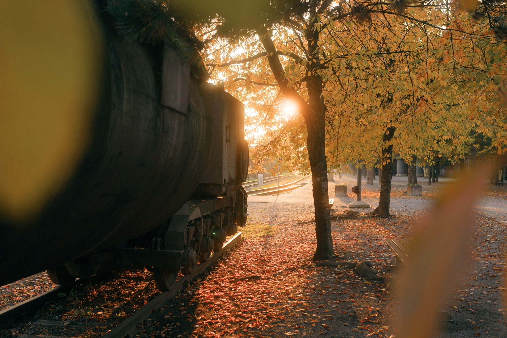
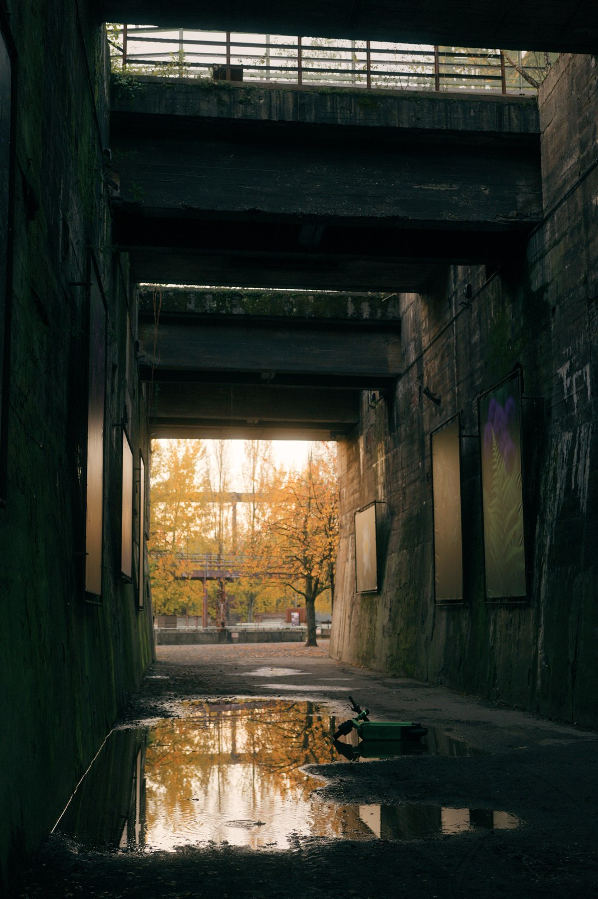
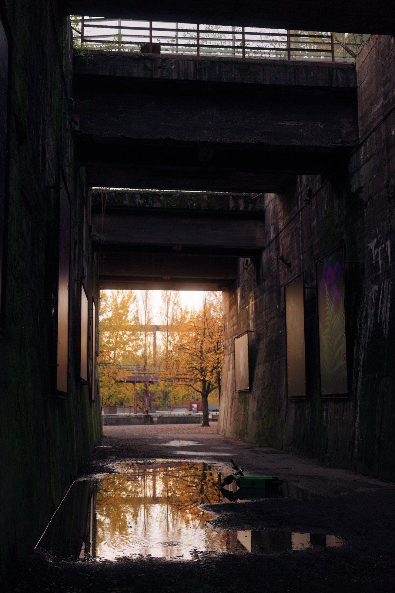
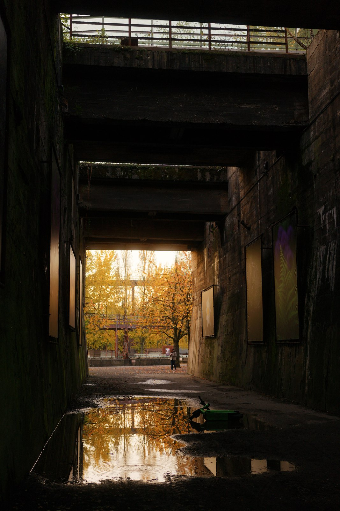
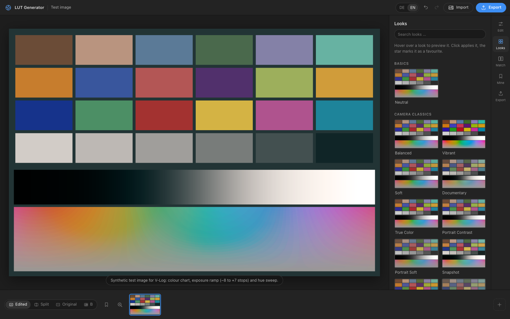
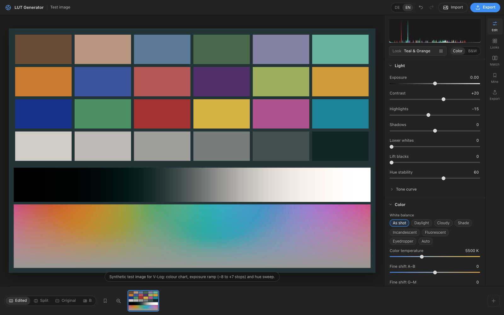
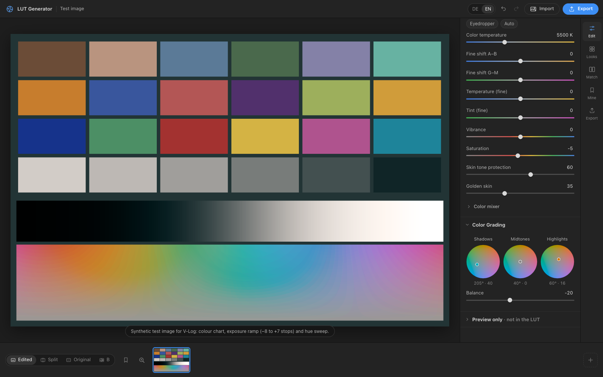
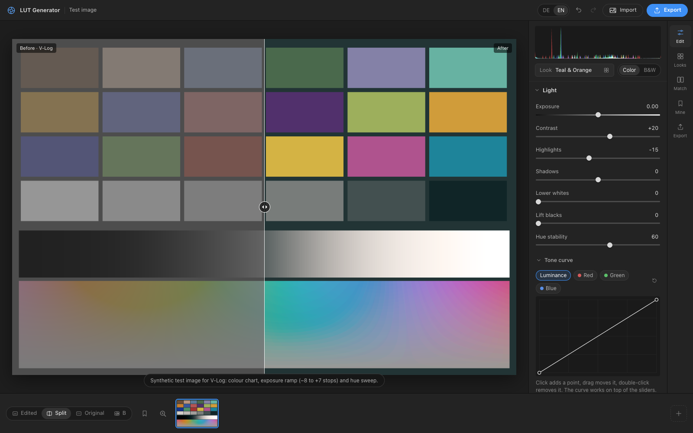
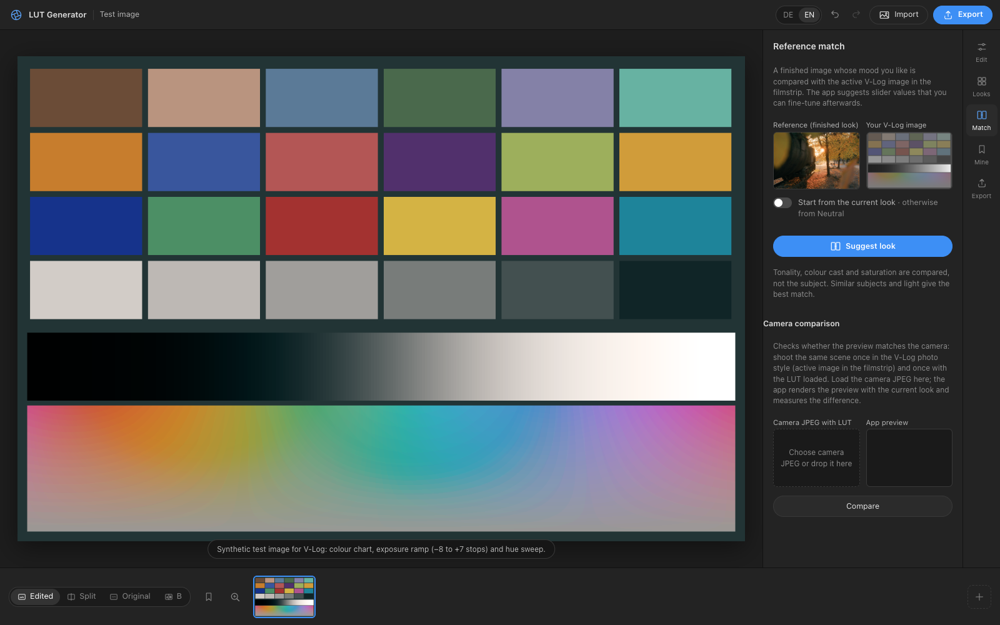
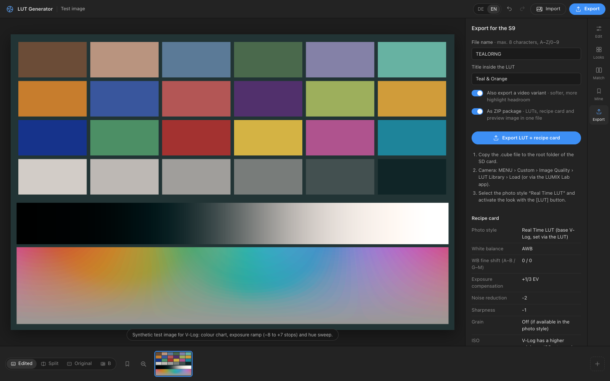

# LUT Generator – Real Time LUTs für die S9 (Deutsch)

[English version](README.md)

Erstellt eigene Looks (klassische Film- und Kamera-Looks, Kino, Schwarzweiß) als `.cube`-LUT für den Bildstil
**Real Time LUT** der S9. Ziel: fertige JPEGs direkt aus der Kamera, ohne RAW-Entwicklung.
Dieselben LUTs funktionieren auch für Video. Als Basis gehen die Bildstile **V-Log** und
**Natural**.

Läuft komplett lokal im Browser. Keine Installation, keine Cloud.

<p align="center"></p>
<p align="center"><sub>Teal &amp; Orange – JPEG direkt aus der LUMIX S9 mit Real Time LUT</sub></p>

## Loslegen – ohne Installation

**Am einfachsten im Browser.** Diese Seite öffnen:

### 👉 [ernestodiescholle.github.io/realtime-lut-builder](https://ernestodiescholle.github.io/realtime-lut-builder/)

am Computer (Chrome, Safari, Edge oder Firefox). Fertig: kein Download, kein Konto, keine Anmeldung.
Deine Fotos werden auf deinem eigenen Computer verarbeitet und nie hochgeladen.

**Lieber offline nutzen?**

1. Auf der [Repo-Startseite](https://github.com/ernestodiescholle/realtime-lut-builder) auf den grünen Button **Code** › **Download ZIP** klicken.
2. Die ZIP-Datei entpacken.
3. `index.html` doppelklicken – die App öffnet sich im Browser und läuft ohne Internet.

Für beide Wege braucht man kein GitHub-Konto. Danach weiter mit dem [Ablauf](#ablauf).

## Beispiele

Direkt aus der Kamera (LUMIX S9, Real Time LUT, JPEG, ohne Nachbearbeitung):

| Teal & Orange | Neon Nacht | Kino-Print warm |
|:---:|:---:|:---:|
|  |  |  |

## Screenshots

Gezeigt mit dem eingebauten synthetischen V-Log-Testbild und dem Look *Teal & Orange* (englische Oberfläche, umschaltbar auf Deutsch).

| | |
|:---:|:---:|
| <br><sub>**Looks** – 73 Start-Looks, Vorschau beim Darüberfahren</sub> | <br><sub>**Bearbeiten** – Licht, Kontrast, Lichter, Schatten</sub> |
| <br><sub>**Tonkurve & Weißabgleich** – Punktkurven (Luminanz, RGB), Weißabgleich wie an der Kamera</sub> | <br><sub>**Farbe** – Sättigung, Hautton-Schutz, Farbmischer, Color-Grading-Räder</sub> |
| <br><sub>**Geteilte Ansicht** – links V-Log, rechts der Look</sub> | <br><sub>**Abgleich** – Referenzbild-Abgleich und Kamera-Vergleich</sub> |
| <br><sub>**Export** – kamerafertige `.cube`, Video-Variante, Rezeptkarte</sub> | |

## Ablauf

1. **Testfotos machen:** An der S9 den Bildstil **V-Log** (oder **Natural**, alle Regler auf 0) wählen und ein paar JPEGs aufnehmen
   (Hauttöne, Grün, Himmel, Gegenlicht, Innenraum). Die Bilder sehen flau aus, das ist richtig.
   Sie entsprechen genau dem, was die LUT in der Kamera als Eingang bekommt.
2. **Look bauen:** Fotos in die App ziehen (mehrere gehen, sie erscheinen unten im Filmstreifen).
   Rechts unter **Looks** einen Startpunkt wählen (Maus darüber = Vorschau), dann unter
   **Bearbeiten** anpassen: Licht, Farbe mit Farbmischer, Color Grading mit Farbrädern.
   Die Vorschau wendet exakt die LUT an, die exportiert wird.
3. **Exportieren:** Ergibt z. B. `TEALOR-V.cube` (Foto), optional `TEALOM-V.cube` (Video-Variante,
   M = Movie: weicher, mehr Reserve in den Lichtern; Schalter im Export-Reiter, standardmäßig aus),
   eine Rezeptkarte mit Kamera-Einstellungen
   und ein Vorschaubild, standardmäßig zusammen als ZIP. Mit Natural enden die Dateien auf `-N`. In der Mac-App wählst du stattdessen
   direkt den Zielordner, z. B. die SD-Karte.
4. **In die Kamera laden:** `.cube` ins **Hauptverzeichnis** der SD-Karte kopieren.
   Dann an der Kamera MENU › Individual › Bildqualität › LUT-Bibliothek › Platz wählen › Laden.
   Alternativ über die App LUMIX Lab.
5. **Fotografieren:** Bildstil **Real Time LUT**, mit der [LUT]-Taste den Look wählen.
   Die Einstellungen von der Rezeptkarte übernehmen.

Ohne eigenes Foto lässt sich alles mit dem eingebauten synthetischen V-Log-**Testbild** ausprobieren.

**Tonkurve:** Unter Licht › Tonkurve gibt es eine Punktkurve wie in gängiger Bildbearbeitung, getrennt für
Luminanz, Rot, Grün und Blau. Klick setzt einen Punkt, Ziehen verschiebt ihn, Doppelklick
entfernt ihn. Sie wirkt zusätzlich zu den Reglern (auf die Werte nach der Tonkurve) und fließt
wie alles andere in die LUT ein. Die Luminanz-Kurve skaliert alle Kanäle gemeinsam, damit
Farbton und Sättigung erhalten bleiben; die Kanalkurven färben gezielt.

**Bedienung:** Doppelklick auf einen Regler oder seinen Namen setzt ihn zurück. Werte lassen sich
auch eintippen. Doppelklick auf ein Farbrad nimmt die Tönung heraus. Taste `\` wechselt zwischen
Bearbeitet und Original, `Y` schaltet den geteilten Vorher/Nachher-Vergleich. `⌘Z` macht den
letzten Schritt rückgängig, `⇧⌘Z` wiederholt ihn (auch über die Pfeile oben rechts).
Bei den Looks gibt es eine Suche, und der Stern auf einem Vorschaubild merkt ihn als Favorit.

## Basis-Bildstil

Die LUT setzt auf den Bildstil **V-Log** oder **Natural** auf. Die App liest ihn beim Laden aus
den Kameradaten jedes Fotos (Panasonic-Makernote) und markiert jedes Bild im Filmstreifen mit
**V** oder **N**; V-Log- und Natural-Fotos lassen sich also mischen. Ohne Kameradaten (z. B.
bearbeitete oder verkleinerte Bilder) schätzt sie anhand der Tonwertspanne; unter **Bearbeiten**
lässt sich der Stil für das aktive Bild umstellen. Der Export richtet sich nach dem aktiven Bild
(`-V` oder `-N`). Alle Looks funktionieren auf beiden und sehen fast gleich aus. Auf
echten Bildpaaren derselben Szene weicht derselbe Look im Mittel nur etwa 3–7 von 255 Stufen ab.

| | Natural | V-Log |
|---|---|---|
| Mindest-ISO an der S9 | 100 | 640 |
| Lichter clippen ab etwa | +4 Blenden über Mittelgrau | +6,5 Blenden |
| Gut für | Alltag, pralle Sonne ohne ND-Filter | Gegenlicht, hohe Kontraste, Video |

V-Log wird mit Panasonics veröffentlichten Formeln zurückgerechnet. Natural mit einer Kurve, die
an der S9 aus 14 Bildpaaren V-Log/Natural mit identischer Belichtung gemessen wurde (ISO 640,
Weißabgleich fest, alle Regler im Bildstil auf 0). Für Natural im Bildstil alle Regler auf 0
lassen. Weitere Basis-Bildstile (HLG, Standard …) sind im Code vorbereitet, aber nur angenähert
und deshalb ausgeblendet (`FEATURES.baseStyles` in `js/app.js`).

## Weißabgleich wie an der Kamera

Unter Farbe › Weißabgleich: Voreinstellungen (Wie aufgenommen, Tageslicht, Bewölkt, Schatten,
Glühlampe, Leuchtstoff), ein **Kelvin-Regler** (5500 K = wie aufgenommen, niedriger = kühler,
höher = wärmer, wie der manuelle Weißabgleich der Kamera) und die **Feinkorrektur A–B / G–M**
in Lumix-Stufen. Dazu eine **Pipette** (auf Graukarte, weißes Papier oder Asphalt klicken, die
App setzt Kelvin und Tönung so, dass die Fläche neutral wird) und **Auto** (Schätzung aus dem
ganzen Bild). Temperatur und Tönung bleiben als Feinregler. Alles landet in der LUT; die
Rezeptkarte nennt zusätzlich den Weißabgleich für die Kamera.

## Lupe, Vorschau-Effekte

- **1:1-Lupe:** Taste `Z` oder das Lupen-Symbol zeigt die Vorschau in voller Größe
  (lange Kante max. 1800 px), Ziehen verschiebt den Ausschnitt. Gut für Übergänge in Himmeln.
- **Nur Vorschau:** Vignette und Körnung nur zur Abschätzung des Gesamteindrucks, sie sind
  nicht Teil der LUT (in der Kamera über Körnungseffekt und Vignettierungskorrektur).
- **Hauttonschutz** (Farbe): schirmt Hauttöne (rötlich bis golden) vor Sättigungs- und
  Farbtonänderungen ab. **Haut goldener** schiebt rosige oder gerötete Haut sanft Richtung
  warmes Orange, wie es Porträtfilme tun. Kräftige Rottöne (Äpfel, Lippen) bleiben unberührt.
  Die Film- und Porträt-Looks haben beides voreingestellt, Neutral und Schwarzweiß nicht.

## Referenzbild-Abgleich

Unter **Abgleich** lädst du ein fertiges Bild, dessen Stimmung dir gefällt (z. B. ein Foto aus
dem Netz oder ein früher bearbeitetes Foto). Die App vergleicht Tonwertverteilung, Farbstich je
Helligkeitsbereich und Sättigung mit dem aktiven V-Log-Bild im Filmstreifen und sucht die
Reglerwerte, die am nächsten herankommen. Das Ergebnis landet als normaler, editierbarer Look
unter **Bearbeiten**, nicht als Black-Box-LUT. Der Vorschlag ist ein Startpunkt: Verglichen werden
Statistiken, nicht das Motiv, deshalb liefern ähnliche Motive und ähnliches Licht die beste
Annäherung. Mehrere Referenzbilder lassen sich gemeinsam laden, dann wird die Statistik
stabiler. Die Berechnung dauert einige Sekunden; währenddessen sollte das Fenster sichtbar
bleiben (Browser bremsen Hintergrund-Tabs stark aus).

## Kamera-Vergleich

Ebenfalls unter **Abgleich**: Dieselbe Szene einmal im Bildstil V-Log und einmal mit der in der
Kamera geladenen LUT fotografieren. V-Log-Bild in den Filmstreifen, Kamera-JPEG in den
Kamera-Vergleich laden, Look wählen, „Vergleichen“. Die App zeigt die Abweichung als Bild und
als Zahlen (mittleres ΔE, 95-%-Wert, Richtung: heller/dunkler, wärmer/kühler). So lässt sich
prüfen, ob Vorschau und Kamera übereinstimmen. Die Messzahlen entstehen stark verkleinert, damit
JPEG-Rauschen nicht mitzählt; das Abweichungsbild ist feiner aufgelöst. Beide Aufnahmen müssen
denselben Bildausschnitt zeigen (Stativ).

## Looks (73)

- **Basis:** Neutral
- **Kamera-Klassiker:** Ausgewogen, Leuchtend, Sanft, Dokumentar, Porträt Kontrast,
  Porträt Sanft, Schnappschuss, Nostalgie, Kino Flach, Bleach Bypass
- **Farbnegativ:** Porträtfilm 160/400/800, Sommerfilm 200, Sonnenlicht-Film, Alltagsfilm 400, Retrofilm 200,
  Minze 400, Kühles Negativ 400, Einfachfilm 200, Rotakzent
- **Dia & Kräftig:** Klassisches Dia, Modernes Dia, Wild 800
- **Kino:** Kinonegativ, Tageslicht-Kino, Teal & Orange, Kino-Print warm, Kino-Print kühl,
  Moody Kino, Warme Wüste, Nordisch kühl
- **Nacht:** Neon Nacht, Kunstlicht 800, Neonregen, Violetter Nebel, Rot & Cyan, Petrol-Regen
- **Beliebte Stile:** Hell & Luftig, Dunkel & Matt, Goldene Stunde, Pastell, Vintage 70er,
  Cross-Entwicklung, Hochzeit sauber, Erdtöne, Sofortbild
- **Editorial:** Abendsalon, Seidenweiß, Rosé matt, Bernstein, Leinen, Klassisch klar, Waldgrün,
  Abendsonne, Marmor, Dramatisch, Beige analog, Honig, Terrakotta, Sandstein, Morgenlicht
- **Schwarzweiß:** SW Fein (auch mit Rot- und Grünfilter), SW Reportage, SW Klassisch,
  SW Nacht, Sepia, SW Hochkontrast, SW Matt, Selen-Ton

Alles eigene Looks, nach Augenmaß oder an Beispielbildern abgestimmt, inspiriert von klassischen analogen Filmcharakteren und aktuellen Editorial-Stilen. Es sind
keine Kopien fremder Profile, und es werden keine Markennamen verwendet.

## Sprache

Oben rechts lässt sich zwischen **Deutsch** und **English** umschalten. Die Wahl wird gemerkt;
beim ersten Start richtet sich die Sprache nach dem Browser. Übersetzungen stehen in
`js/i18n.js`, die englischen Look-Texte direkt in `js/presets.js`.

## Lokaler Webserver (für Entwicklung)

Nur zum Entwickeln nötig – zum Nutzen reicht der Doppelklick auf `index.html` (siehe oben).
Im Projektordner:

```bash
python3 -m http.server 8765
```

Dann <http://localhost:8765> öffnen.

## Mac-App (Tauri 2, optional)

Die App lässt sich als native Mac-App verpacken. Voraussetzungen: Xcode Command Line Tools,
Rust (rustup) und Node. Dann:

```bash
npm install
```

```bash
npm run app:build
```

Das Ergebnis liegt unter `src-tauri/target/release/bundle/macos/LUT Generator.app` (und als
`.dmg` daneben). Beim ersten Start meldet macOS „nicht verifiziert“, weil die App nicht
signiert ist: Rechtsklick › Öffnen genügt einmalig. Die App ist dieselbe Web-Oberfläche in
einem nativen Fenster; der Export schreibt direkt in einen gewählten Ordner (SD-Karten werden
vorgeschlagen). `npm run app:dev` startet sie zum Entwickeln.

## Technik

- Eingang: Panasonic V-Log / V-Gamut (Formeln aus Panasonics Referenzdokument), Full Range.
- Ausgabe: Rec.709-Primärfarben, sRGB-kodiert (das, was im JPEG landet).
- Verarbeitung: Gamut-Kompression am Eingang, filmische Tonkurve pro Kanal (Mittelgrau bleibt
  Mittelgrau), **Farbton-Stabilität** (hält den Farbton kräftiger Farben in den Lichtern, damit
  Orange nicht nach Gelb kippt; Regler unter Licht), Farbarbeit in OKLab (HSL-Bänder, Sättigung
  und Dynamik mit Grau- und Schattenschutz, Color Grading mit drei Farbrädern für Schatten,
  Mitteltöne und Lichter), Schwarzweiß mit Farbfiltern, weiches Auslaufen an der sRGB-Grenze.
- Vorschau: tetraedrische Interpolation der LUT, wie sie Kameras und Grading-Software nutzen.
- Datei: `.cube`, 33er-Gitter, Tag `#LUMIXPHOTOSTYLE VLOG` oder `NAT` direkt unter dem Titel.
  Dateiname maximal 8 Zeichen (Grenze bei SD/SDHC-Karten mit FAT32): Name (bis 6 Zeichen) plus
  `-V` (V-Log) oder `-N` (Natural); die Video-Variante ersetzt das 6. Zeichen durch `M`,
  z. B. `TEALOR-V.cube` und `TEALOM-V.cube`.
- „Meine Looks“ werden im Browser gespeichert (localStorage). Über „Alle als Datei sichern“
  gibt es eine JSON-Sicherung.

## Grenzen

- Eine LUT färbt jeden Pixel unabhängig um. Körnung, Vignette, Schärfe, Klarheit und der rote
  Lichthof (Halation) mancher Kinofilme sind damit nicht möglich. Körnung und Schärfe kommen,
  soweit vorhanden, aus den Kamera-Einstellungen.
- Die Presets sind nach Augenmaß bzw. an Beispielbildern abgestimmt und an echten S9-Fotos in V-Log
  und Natural geprüft. Wie ein Look wirkt, hängt trotzdem stark von Motiv und Licht ab.
- Ein 33er-Gitter glättet die Funktion bei sehr kräftigen Farben nahe der Farbraumgrenze
  (z. B. tiefes Grün bei sehr kräftigen Looks) um bis zu etwa 7 %. Bei Alltagsfarben liegt die
  Abweichung unter 1,5 %. Die Vorschau zeigt immer das Gitter-Ergebnis, also das, was die Kamera macht.
- In V-Log gilt an der Kamera eine höhere Mindest-ISO.
- Auf dem iPhone Fotos über **„Datei auswählen“** (Dateien-App) laden, nicht aus der Fotos-Mediathek:
  Die Mediathek gibt eine neu kodierte Kopie ohne Kameradaten heraus, dann muss die App V-Log oder
  Natural schätzen (meist richtig, sonst unter **Bearbeiten** umstellen).

## Tests

```bash
node tests/run.js
```

Prüft V-Log-Formeln, Gamut-Matrizen, OKLab, Tonkurve, Punktkurven, Farbton-Stabilität, Grau- und Schattenschutz,
Mitteltöne-Rad, tetraedrische Interpolation, alle Presets (Wertebereich, Grauachse, Genauigkeit der
33er-LUT gegenüber der Farbfunktion), `.cube`-Format und Dateinamen.

## Credits und Lizenz

Erstellt von [ernestodiescholle](https://github.com/ernestodiescholle). Veröffentlicht unter der
[MIT-Lizenz](LICENSE).

Inoffizielles Projekt ohne Verbindung zu Panasonic. LUMIX und V-Log sind Marken der Panasonic
Holdings Corporation; sie werden hier nur beschreibend genannt, um zu sagen, wofür das Werkzeug
gedacht ist. Die Looks sind eigene Kreationen und stehen in keiner Verbindung zu Film- oder
Kameraherstellern.
