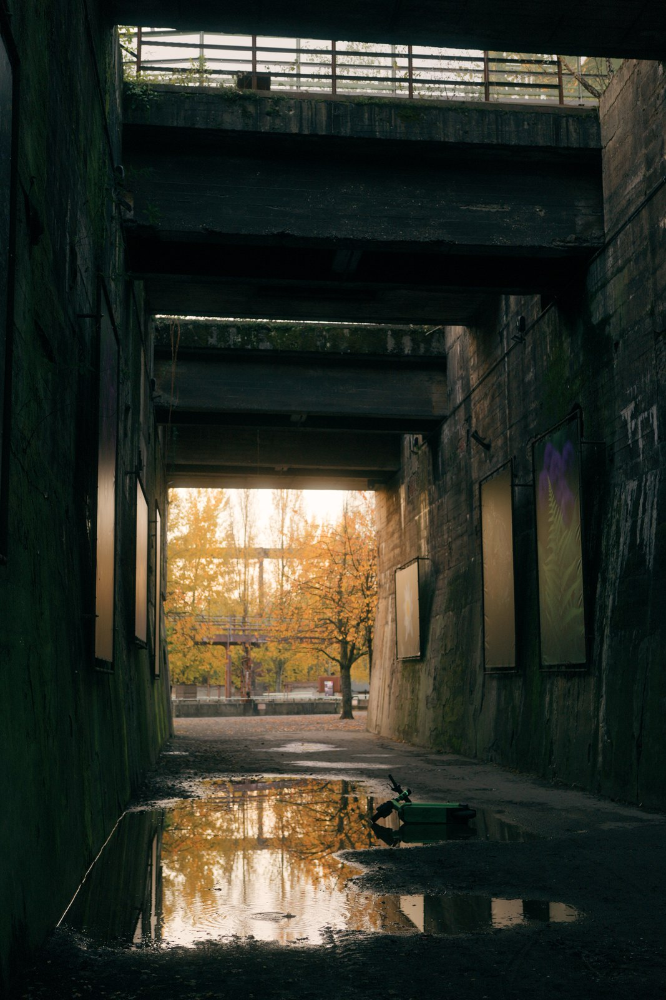
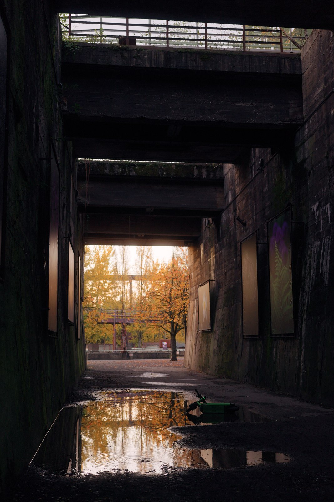
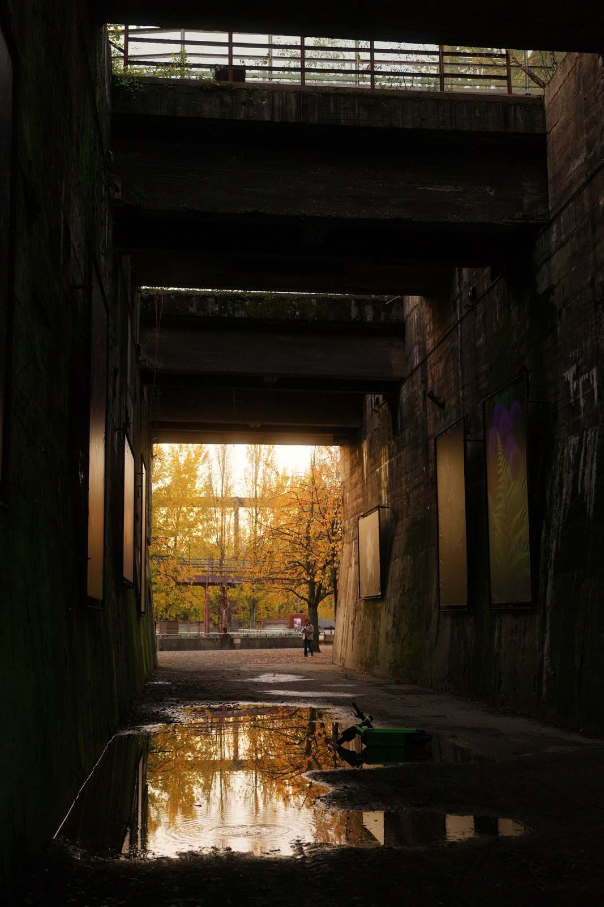
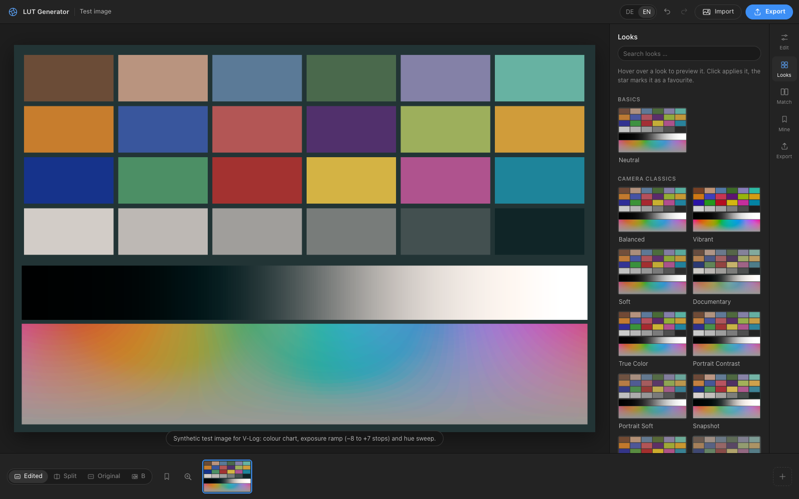
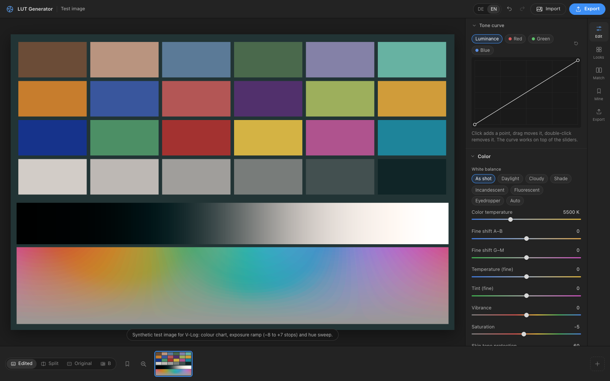
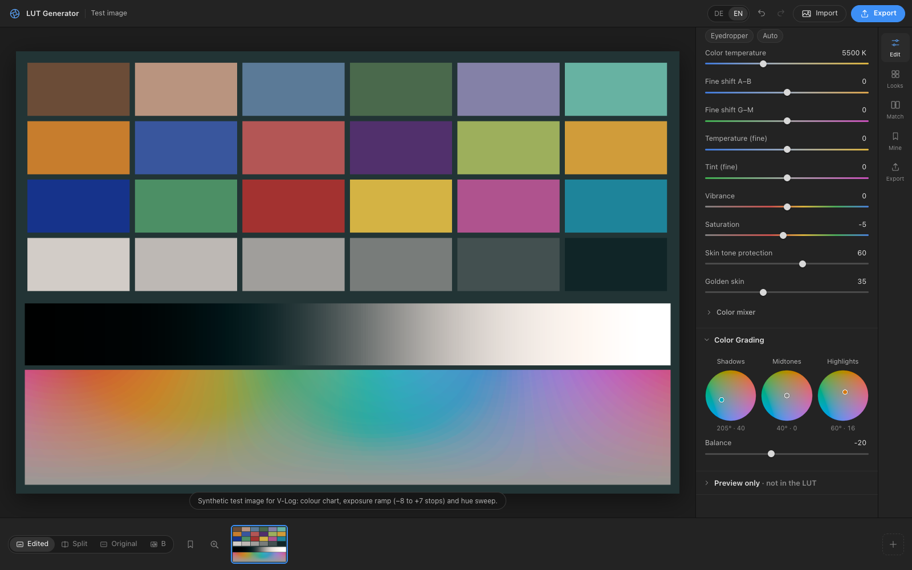
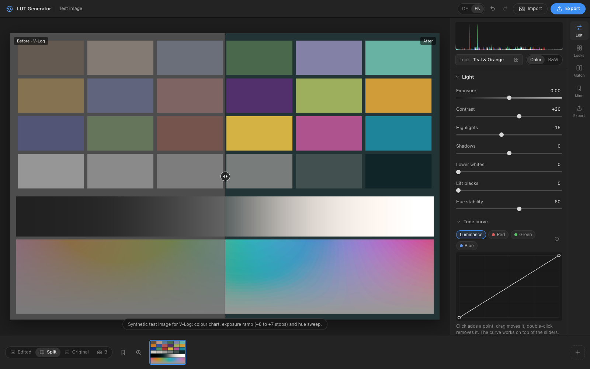
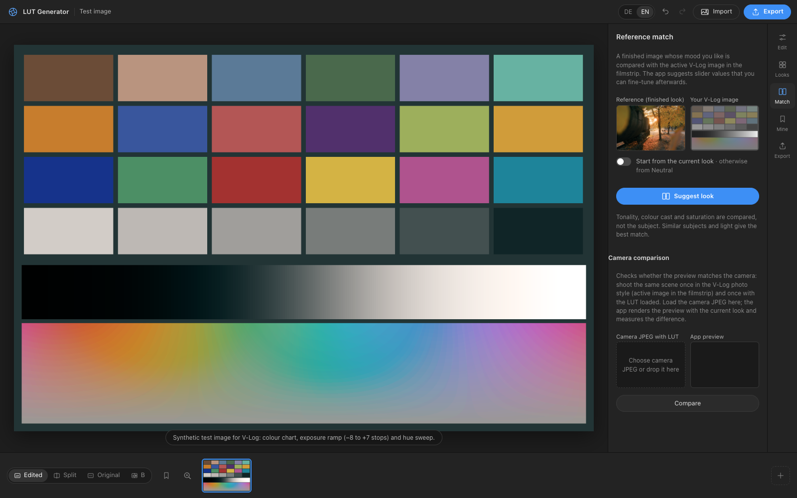
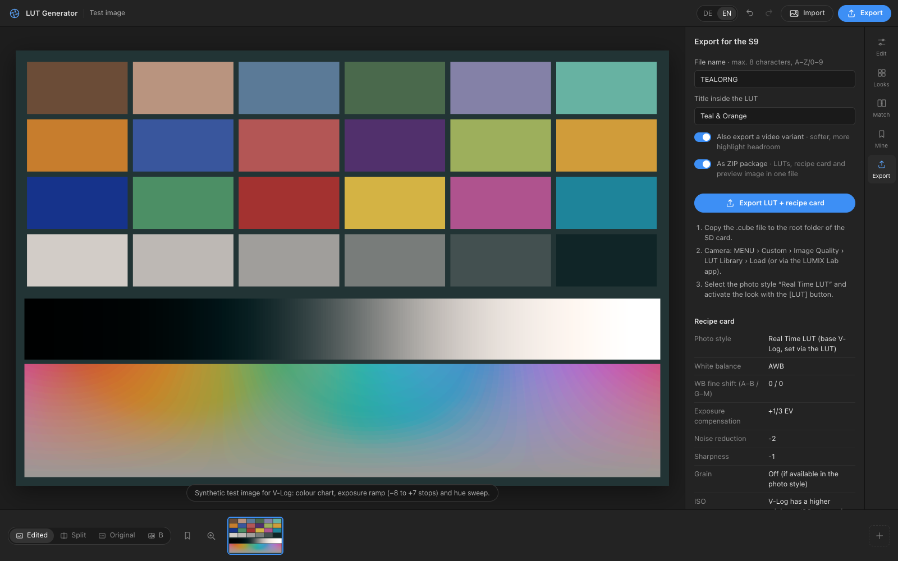

# LUT Generator – Real Time LUTs for the S9

[Deutsche Version](README.de.md)

Build your own looks as `.cube` LUTs for the **Real Time LUT** photo style of the Panasonic
LUMIX S9 (and likely other LUMIX cameras with Real Time LUT). The goal: finished JPEGs straight
out of the camera, no RAW editing. The same LUTs also work for video.

It runs entirely in your browser. No installation, no account, no upload – your photos never
leave your computer.

<p align="center"></p>
<p align="center"><sub>Teal &amp; Orange – JPEG straight out of the LUMIX S9 with Real Time LUT</sub></p>

## Get started – no installation

**Easiest: use it in your browser.** Open

### 👉 [ernestodiescholle.github.io/realtime-lut-builder](https://ernestodiescholle.github.io/realtime-lut-builder/)

on a computer (Chrome, Safari, Edge or Firefox). That's it: no download, no account, no sign-up.
Your photos are processed on your own computer and are never uploaded.

**Prefer to use it offline?**

1. On the [repository page](https://github.com/ernestodiescholle/realtime-lut-builder), click the green **Code** button › **Download ZIP**.
2. Unzip the file.
3. Double-click `index.html` – the app opens in your browser and works without internet.

No GitHub account needed for either way. Then continue with [How to use](#how-to-use).

## Examples

Straight out of the camera (LUMIX S9, Real Time LUT, JPEG, no editing):

| Teal & Orange | Neon Night | Cinema Print Warm |
|:---:|:---:|:---:|
|  |  |  |

## Screenshots

Shown with the built-in synthetic V-Log test image and the *Teal & Orange* look.

| | |
|:---:|:---:|
| <br><sub>**Looks** – 57 starting looks, hover to preview</sub> | <br><sub>**Edit** – light, contrast, highlights, shadows</sub> |
| <br><sub>**Tone curve & white balance** – point curves (luminance, RGB), camera-style WB</sub> | <br><sub>**Colour** – saturation, skin tone protection, colour mixer, grading wheels</sub> |
| <br><sub>**Split view** – V-Log before, look after</sub> | <br><sub>**Match** – reference match and camera comparison</sub> |
| <br><sub>**Export** – camera-ready `.cube`, video variant, recipe card</sub> | |

## Features

- **57 looks to start from:** camera classics, colour negative, slide, cinema, popular styles
  and black & white – all original looks, tuned by eye on real S9 V-Log files.
- **Editor:** exposure, contrast, highlights, shadows, matte blacks/whites, point curves
  (luminance and RGB), colour mixer (8 bands), colour grading wheels (shadows, midtones,
  highlights), vibrance, saturation, skin tone protection.
- **White balance like on the camera:** presets, Kelvin, A–B / G–M fine shift, eyedropper and
  auto.
- **Exact preview:** the preview applies exactly the LUT that gets exported, decoded with
  Panasonic's published V-Log/V-Gamut formulas.
- **Camera-ready export:** 33-point `.cube` with the `#LUMIXPHOTOSTYLE VLOG` tag, file names
  limited to 8 characters, optional softer video variant and a recipe card with suggested
  camera settings (white balance, exposure, noise reduction, sharpness, grain).
- **Reference match:** load a finished photo whose mood you like and get slider values as a
  starting point.
- **Camera comparison:** compare an in-camera JPEG shot with your LUT against the app preview.
- **Extras:** A/B comparison, 1:1 loupe, before/after split, undo/redo, favourites, saved looks,
  vignette and grain preview, English and German UI.

## How to use

1. **Shoot test photos:** set the camera to the **V-Log** photo style and take a few JPEGs
   (skin, greenery, sky, backlight, interior). They look flat – that is correct. They are exactly
   what the LUT receives inside the camera.
2. **Build a look:** drop the photos into the app, pick a starting look under **Looks**
   (hover = preview), then refine it under **Edit**.
3. **Export:** you get `NAME.cube` (photo), optionally `NAMEV.cube` (video variant), a recipe
   card `NAME.txt` and a preview image, by default bundled as `NAME_LUT.zip`.
4. **Load it into the camera:** copy the `.cube` file to the **root folder** of the SD card, then
   on the camera: MENU › Custom › Image Quality › LUT Library › choose a slot › Load
   (or use the LUMIX Lab app).
5. **Shoot:** select the photo style **Real Time LUT** and pick your look with the [LUT] button.
   Use the settings from the recipe card.

No photo at hand? The built-in synthetic V-Log test image lets you try everything.

**Tips**
- Expose V-Log carefully: in bright scenes the camera tends to meter a bit low. +1/3 to
  +2/3 EV often helps.
- A LUT changes every pixel independently. Grain, vignette, sharpness, clarity and halation
  cannot be part of a LUT – use the camera settings for grain and sharpness.
- The app warns you when a loaded image does not look like plain V-Log (e.g. a Standard JPEG or
  V-Log with a LUT already applied).

## Development

No build step and no dependencies for the web app – plain HTML, CSS and JavaScript.

### Local web server

Only needed for development – everyone else can just double-click `index.html` (see above).
To serve the app locally, run this in the project folder:

```bash
python3 -m http.server 8765
```

Then open <http://localhost:8765>.

### Mac app (Tauri 2, optional)

The same web app in a native window that can write LUTs directly to your SD card. Requires
Xcode Command Line Tools, Rust and Node:

```bash
npm install
```

```bash
npm run app:build
```

The app ends up in `src-tauri/target/release/bundle/`. It is not signed; on first launch use
right-click › Open.

```bash
node tests/run.js
```

runs about 1,400 checks: V-Log/V-Gamut math, tone curves, colour handling, LUT accuracy of every
look, `.cube` format, file names and translations.

| File | Purpose |
|---|---|
| `js/color.js` | V-Log/V-Gamut, Rec.709/sRGB, OKLab, HLG |
| `js/grade.js` | Look engine: parameters → colour function → 3D LUT, `.cube` export |
| `js/presets.js` | The bundled looks (German and English texts) |
| `js/app.js` | User interface |
| `js/i18n.js` | German/English translations |
| `js/match.js` | Reference match |

Tested on the S9 only. Feedback from other cameras with Real Time LUT is very welcome.

## Credits

Created by [ernestodiescholle](https://github.com/ernestodiescholle).

## License

[MIT](LICENSE)

## Disclaimer

This is an unofficial hobby project and is not affiliated with, endorsed by or connected to
Panasonic. LUMIX and V-Log are trademarks of Panasonic Holdings Corporation and are used here
only to describe what the tool is for. The bundled looks are original creations and are not
affiliated with any film or camera manufacturer.

---

## Kurzfassung auf Deutsch

Erstellt eigene Looks als `.cube`-LUT für den Bildstil **Real Time LUT** der LUMIX S9: V-Log-Foto
laden, Look wählen und anpassen, exportieren, `.cube` ins Hauptverzeichnis der SD-Karte kopieren
und an der Kamera über MENU › Individual › Bildqualität › LUT-Bibliothek laden. Läuft komplett
im Browser, nichts wird hochgeladen. Ausführliche deutsche Anleitung: [README.de.md](README.de.md).
